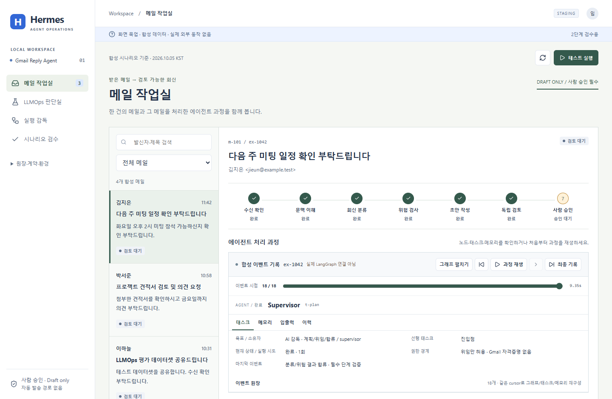
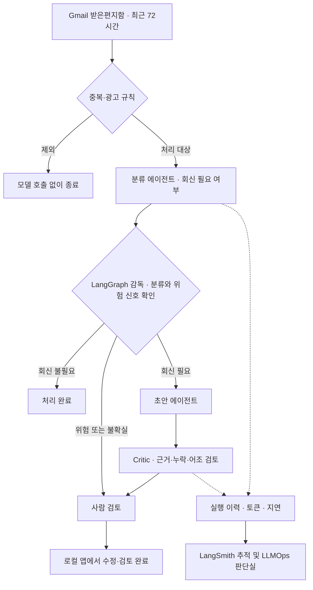
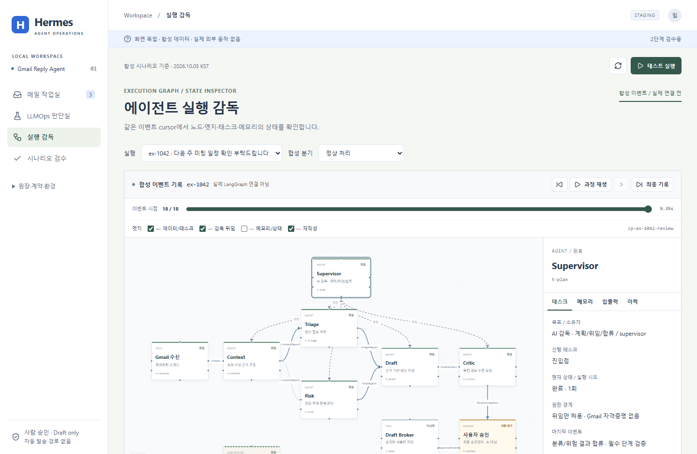
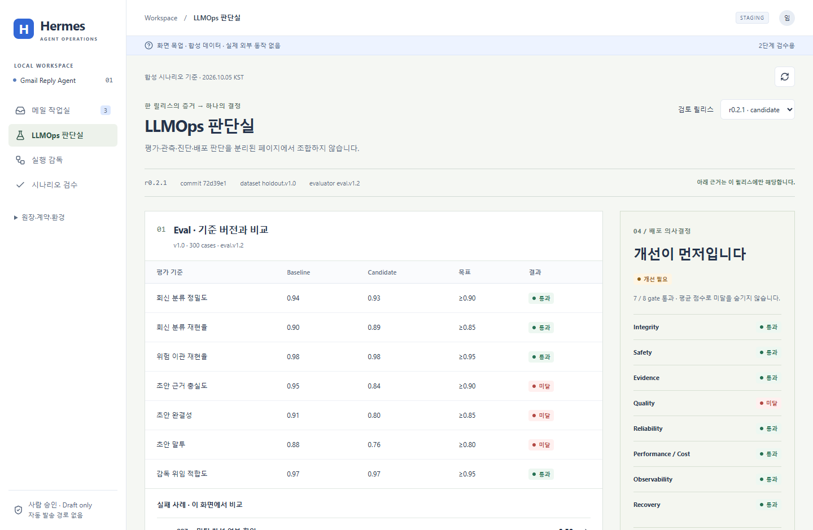

# Hermes Gmail Reply Agent

Gmail 받은편지함에서 회신이 필요한 메일을 찾아 답장 초안을 만드는 로컬 에이전트입니다. 메일을 직접 골라 실행할 필요 없이 새 수신을 확인하고, 초안과 판단 근거를 웹 콘솔에서 검토할 수 있습니다.

[빠른 시연](#빠른-시연) · [처리 흐름](#처리-흐름) · [검증 결과](#검증-결과) · [실제 Gmail 연결](#실제-gmail-연결)



*README의 화면은 합성 데이터 모드에서 캡처했습니다.*

## 처리 흐름



비용 절약 모드에서는 분류에 모델을 한 번 호출하고, 회신이 필요한 경우에만 초안 작성과 Critic 호출을 추가합니다. 명확한 광고는 로컬 규칙으로 걸러냅니다. Gmail 연결은 읽기 전용이며 초안은 로컬 앱에서 검토합니다.

## 한 건의 실행을 따라가는 화면

| 화면 | 확인할 수 있는 것 |
|---|---|
| [메일 작업실](docs/screenshots/mail-workbench.png) | 원문, 분류 이유, 회신 초안, 사람 검토 |
| [실행 감독](docs/screenshots/supervision.png) | 에이전트 노드, 실행 경로, 단계별 상태 |
| [LLMOps 판단실](docs/screenshots/llmops.png) | 평가 점수, 토큰·지연, 진단, 버전별 배포 판단 |

<details>
<summary>실행 감독과 LLMOps 화면 보기</summary>





</details>

## 빠른 시연

**Node.js 22.12 이상**에서 프런트엔드의 합성 데이터 모드를 실행합니다. Gmail이나 모델 API 키 없이 둘러볼 수 있습니다.

```powershell
cd frontend
npm ci
npm run dev
```

[메일 작업실](http://127.0.0.1:5173/)에서 합성 메일을 열고, [실행 감독](http://127.0.0.1:5173/supervision)과 [LLMOps 판단실](http://127.0.0.1:5173/operations)을 확인합니다. [시나리오 검수](http://127.0.0.1:5173/scenarios)에서는 성공과 실패·복구 흐름을 살펴볼 수 있습니다.

## 검증 결과

| 항목 | 확인한 결과 |
|---|---|
| 실제 메일 | 별도 계정에서 보낸 테스트 메일을 자동 감지하고 회신 초안 생성 |
| 실행 추적 | 실제 Gmail 실행 19건의 LangSmith 전달 커버리지 100%. 전송 재개 후 기존 대기 이벤트 852개를 전송하고 원격에서 대조 |
| 개발 평가 | 합성 사례 2건. 분류 결과와 정답 라벨을 대조하고 초안의 근거·요청 반영·어조를 별도 평가 |
| 자동화 테스트 | 백엔드 48건, 실제 API 흐름과 자동 메일함 브라우저 테스트 각 1건 통과 |

위 수치는 구현 당시의 검증 기록입니다. 운영 판정은 **HOLD**이며, 운영 수준의 분류 정확도와 초안 채택률은 미측정입니다. [검증 및 운영 범위](docs/18-automatic-gmail-review.md)

## 실제 Gmail 연결

Windows의 로컬 런타임은 Python·Node.js 환경과 Gmail OAuth, OpenAI API 설정이 필요합니다. LangSmith를 연결하면 전송 기록을 조회할 수 있습니다.

1. [도구 설치](docs/10-tool-setup.md)와 [계정·키 설정](docs/11-account-setup-guide.md)을 따라 환경을 구성합니다.
2. `frontend`에서 `npm ci`와 `npm run build:api`를 실행합니다.
3. 프로젝트 루트에서 `Open-Console.cmd`를 실행하고 자동으로 열린 인증 탭을 사용합니다.
4. 실제 메일 본문을 모델에 전송하기 전에 [자동 처리 설정과 데이터 범위](docs/18-automatic-gmail-review.md)를 확인합니다.

실제 메일 분류에 필요한 본문은 OpenAI로 전달됩니다. LangSmith에는 메일 본문·주소·초안 대신 실행 메타데이터, 토큰 사용량, 지연, 점수를 기록합니다. 자격 증명은 Windows Credential Manager를 사용합니다.

## 기술 구성

| 영역 | 기술 |
|---|---|
| 에이전트 | LangGraph, GPT-5.4 mini, Nous Research Hermes Gateway |
| 백엔드·저장 | Python 3.12, FastAPI, SQLite 체크포인트, Gmail API와 OAuth 2.0 |
| 관측·평가 | LangSmith Trace와 Experiments, 로컬 릴리스 기준 |
| 웹 콘솔 | React, TypeScript, Vite, React Flow, Recharts |
| 테스트 | pytest, Playwright |

개인 실습 프로젝트입니다. 요구사항과 검수 기준은 직접 정했고, Codex를 활용해 설계 초안·코드·테스트를 작성했습니다. Gmail을 연결한 뒤 다른 계정에서 테스트 메일을 보내 자동 처리 흐름을 직접 확인했습니다.

[PRD](docs/01-prd.md) · [시스템 설계](docs/02-architecture.md) · [보안 및 LLMOps](docs/03-security-and-llmops.md)
