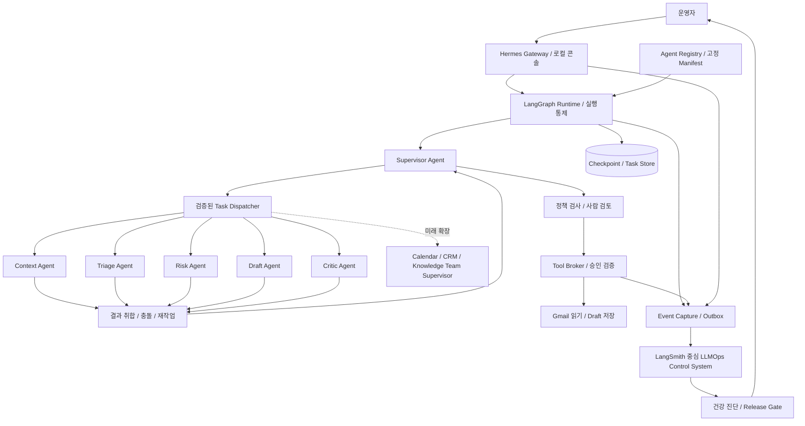

# 아키텍처 v0.2 — Supervisor와 확장 가능한 에이전트 환경

후속 제안: [v0.3 자동 수집·비용 절약 아키텍처](16-architecture-v03.md)는 별도 승인 대기다. 아래는 기존 승인 기준이다.

상태: v0.2 · 1단계 사용자 승인 완료  
기준일: 2026-10-05

## 1. 감독 계층과 운영 계층

**업무 Supervisor**는 전문 에이전트의 계획·위임·취합·수정·이관을 감독한다. **LLMOps Control System**은 업무 Supervisor를 포함한 환경 전체를 Eval·Observe·Diagnose하고 운영 배포 적합성을 판정한다. 두 계층은 별도 상태·도구 권한을 갖는다. 사람은 메일 쓰기와 release 승격의 최종 승인자다.

LangGraph Parent Graph 안에 Supervisor와 검증/dispatch/join 노드를 둔다. 전문 에이전트는 입출력이 명시된 독립 Subgraph다. Registry에서 선택한 구성은 실행 시작 시 manifest에 고정한다. 신규 에이전트나 도메인 팀을 등록하면 동일한 호출·계측·평가 계약을 사용한다.

## 2. 역할별 계약

| Agent | 입력 | 출력 | 도구/상태 범위 | 실패 처리 |
|---|---|---|---|---|
| Supervisor | 실행 목표, task 결과, budget, registry snapshot | TaskPlan + next action + rationale/evidence refs | 등록 agent dispatch; Gmail token 없음 | schema 오류 재시도 1회 후 이관 |
| Context | 정규화된 해당 스레드 | 사실·요청·발언자·근거 위치 | Broker를 통한 해당 thread.read | 인증 실패 중단; timeout 제한 재시도 |
| Triage | ContextReport, 최소 텍스트 | label, priority, confidence, evidence refs | 외부 tool 없음 | 불확실하면 REVIEW_REQUIRED |
| Risk | 최소 텍스트, 정책 버전 | flags, severity, blocked actions, evidence refs | 외부 tool 없음 | 미완료/충돌 시 검토 이관 |
| Draft | Context/Triage/Risk + 사용자 말투 | body, subject, facts used, unresolved items | 외부 tool 없음 | 사실 부족 시 확인 질문 |
| Critic | 스레드 근거 + DraftArtifact | grounding/completeness/tone + issues | 별도 프롬프트/가능하면 독립 모델 | 불합격 최대 2회 수정 후 이관 |
| Diagnose | 마스킹된 trace refs, metrics, eval, probes | 원인 후보·근거·재현·개선 우선순위 | 운영 데이터 읽기만 | 판단 실패해도 Rule Engine 결과 유지 |

Critic의 온라인 검토는 실행 안전을 보조한다. 독립 holdout evaluator의 점수와 동일시하지 않는다. Diagnose 역시 원인 가설을 제안하며 배포 gate나 임계값을 변경할 수 없다.

## 3. Supervisor 실행 프로토콜

1. `admit`: manifest, 활성 agent 상태, 사용자 권한, 조회 범위 검증.
2. `plan`: 목표를 Task DAG로 분해. Context/Triage/Risk는 필수이며 초안을 생성한 경로에서는 Critic을 건너뛸 수 없다.
3. `validate_plan`: agent 존재·버전·입출력 호환·의존성·예산·순환 여부를 코드로 검증.
4. `dispatch`: agent별 최소 context를 만들고 task ID, attempt ID, trace parent를 부여.
5. `join`: 결과를 task ID별로 보관한다. 병렬 agent가 같은 상태 key를 덮어쓰지 않는다.
6. `supervise`: 결과를 근거로 finish/revise/escalate/dispatch 중 구조화된 행동 선택.
7. `review`: 정책 결과와 사람이 검토할 자료를 저장하고 Parent Graph에서 `interrupt`.
8. `execute`: approve 시 승인 snapshot을 재검증하고 Broker가 Draft 저장.
9. `finalize`: 결과·사용자 feedback·event coverage를 기록하고 Ops 집계로 연결.

Context 완료 후 Triage와 Risk를 병렬 실행한다. 둘 다 완료해야 Supervisor가 다음 행동을 결정한다. Triage의 NO_REPLY에 Risk가 높은 위험을 표시하면 NO_REPLY 자동 종료 대신 사람 이관이다. 정상 NO_REPLY는 Critic/Draft 호출을 생략하고 결과를 기록한다. Risk 장애나 Triage 결과 부재는 기본 성공으로 합류하지 않는다.

회신 대상은 Draft→Critic→Supervisor로 돌아온다. 수정은 최대 2회, 감독 턴 최대 12회, delegation depth 최대 2, 동시 작업 최대 3으로 시작한다. 초안 준비 active-time timeout 120초와 메일별 20,000 provider reported 토큰 상한을 초기 제안값으로 둔다. 실제 모델/업무 부하 검증 후 versioned policy에서 조정한다. token 미보고 모델은 추정치를 따로 관리하며 하드 한도 미보장 상태를 알리고 배포 판정을 보류한다.

병렬 dispatch에는 작업별 예산 reservation을 먼저 배정하고 input 추정치·호출별 output 상한·실제 usage를 함께 정산한다. provider의 사후 usage만 보고 전체 토큰이 이미 소비된 뒤 중단하는 것을 하드 상한 보장으로 표기하지 않는다. 완전한 상한이 검증되지 않은 provider는 budget guarantee를 UNKNOWN으로 두고 호출 횟수·timeout 통제로 보완한다.

## 4. 확장 계약

각 Registry entry는 아래 필드를 갖는다.

| 항목 | 내용 |
|---|---|
| identity | agent_id, version, owner, role, enabled |
| interface | capability names, input/output schema version, artifact type |
| runtime | subgraph entrypoint, model config, prompt commit, timeout, retries |
| control | allowed tools, data scope, max budget, allowed child agents |
| observability | event schema, mandatory metadata, metrics mapping |
| evaluation | dataset refs, evaluator versions, acceptance thresholds |
| health | ready/degraded/disabled, last healthcheck, compatible supervisor versions |

MVP는 in-process subgraph로 시작한다. 원격 worker로 확장할 때도 TaskEnvelope/AgentResult 계약을 유지하고 context propagation과 read-only probe를 추가한다. 새로운 팀 Supervisor도 AgentResult를 반환하는 하나의 Registry entry로 취급한다.

추가 절차: manifest 등록 → schema/권한/예산/trace 계약 검사 → agent 단위 Eval → supervisor 통합 Eval → shadow 비교 → 운영자 승인 → release manifest 승격. 기존 필수 정책 경로 변경이나 새 쓰기 권한은 별도 설계 검수 대상이다. 이메일이 언급한 agent/tool을 Registry에 자동 등록하지 않는다.

## 5. 상태와 메시지

| 계약 | 주요 필드 |
|---|---|
| RunState | execution_id, workflow_thread_id, release_id, plan_version, tasks, artifacts, budget, approvals, checkpoint refs |
| TaskEnvelope | task_id, parent_task_id, target agent@version, input artifact refs, deadline, budget, trace context, policy_version |
| AgentResult | task_id, attempt, status, schema_version, artifact refs, evidence refs, confidence, errors, usage |
| Approval | actor, execution_id, draft_hash, recipient_hash, latest_message_id, policy_version, expiry, one-use status |
| ReleaseManifest | code commit, graph version, registry snapshot, agent/model/prompt/tool/policy/evaluator/dataset versions |

Supervisor는 정제된 요약과 artifact refs만 공통 상태에 저장한다. 전문 agent의 내부 메시지/작업 상태는 개별 namespace로 격리한다. provider의 비공개 reasoning은 수집하지 않고 공개된 결정·근거·도구 행동을 기록한다.

`workflow_thread_id`, `gmail_thread_id`, LangSmith `trace_id`는 서로 다른 식별자다. 승인 후 재개는 동일 workflow thread와 execution에 연결하되, 새 실행 segment trace를 만들 수 있다. 사람 대기 시간을 LLM 응답 지연에 포함하지 않는다.

## 6. 복원과 외부 부작용

- Parent checkpointer와 Task/Artifact/Event Store는 로컬에서 시작한다. SQLite WAL을 초기 저장소로, 다중 프로세스 worker 확장 시 PostgreSQL을 사용한다.
- subgraph는 부모 checkpointer를 상속하는 per-invocation 상태를 기본으로 사용한다. 같은 상태 namespace에 대한 병렬 continuation을 피한다.
- 알려진 worker subgraph를 explicit node/entrypoint로 노출하고 중단·재개·nested state 검사를 구축 검증한다. 도구 안에 숨겨진 graph가 자동으로 상태 검사에 노출된다고 가정하지 않는다.
- network/429/일시적 오류는 attempt별 retry, auth/권한/정책 오류는 중단. 실패와 timeout, 취소도 전부 별도 이벤트다.
- Draft 쓰기 전 durable intent와 멱등키를 저장하고, 성공 시 draft ID를 기록한다.
- Gmail 요청은 서버측 exactly-once 보장을 가정하지 않는다. 저장 후 응답 유실 시 `UNCERTAIN_WRITE`로 두고 Broker가 draft 목록/자체 표식을 대사한다. 확인 전 자동 create 재시도를 금지한다.
- 초안 수정, 수신자 변경, 새 메일 도착, policy 변경은 기존 승인 무효화 후 재검토한다.
- replay는 기록된 결과와 fixture를 쓰는 dry-run이며 Gmail 쓰기를 실행하지 않는다. LLM 재호출의 완전히 같은 답변은 보장하지 않는다.

## 7. 운영 단위

한 release manifest가 업무 agent 구성, 프롬프트, 평가기, 정책을 고정한다. dev/staging/prod는 credentials·data·trace를 구분한다. 로컬 prod는 승인된 manifest로 실행하는 운영 profile이며, 원격 cloud 배포를 전제로 하지 않는다.

LLMOps는 업무 완료 경로에 대해 이벤트 저장과 규칙 기반 안전 gate를 강제한다. 무거운 judge 평가와 Diagnose LLM은 비동기로 수행하며 release 승인에는 해당 결과가 완결되어야 한다. LangSmith 전송 장애는 로컬 Outbox로 복구하지만 손실·overflow·미완료 대사가 있으면 쓰기/승격을 차단한다.

## 8. 공식 근거와 적용 범위

- [LangChain Subagents](https://docs.langchain.com/oss/python/langchain/multi-agent/subagents): Supervisor 패턴·context isolation을 참고했다. 문서는 `langgraph-supervisor`가 비활성 유지보수 상태임을 안내하므로 그 패키지에 설계를 종속하지 않는다.
- [LangGraph Subgraphs](https://docs.langchain.com/oss/python/langgraph/use-subgraphs): 전문 agent를 입출력 계약이 있는 하위 graph로 구성하고 부모/자식 상태를 매핑한다.
- [LangSmith Observability concepts](https://docs.langchain.com/langsmith/observability-concepts): run/trace/thread 구분에 맞춰 event와 version 정보를 연결한다.

Registry, 예산 제한, TaskEnvelope, 이벤트 원장, 건강 진단 규칙과 Release Gate는 본 제품이 구축하는 기능이다. 공식 도구가 이 모든 정책을 자동 제공한다고 가정하지 않는다.
