# 아키텍처 v0.3 — 자동 수집과 예산을 감독하는 환경

**후속 사용자 지시:** 블랙톤·목업 단계와 누적 금액 예산 통제는 취소. 기존 화이트톤의 자동 Gmail 구현·검증을 승인했으며 [최신 실행 안내](18-automatic-gmail-review.md)를 따른다. 아래는 변경 전 설계 제안 기록이다.
상태: **제안 · 승인 대기** / 2026-11-02. 현재 실행 중인 v0.2/구축본의 동작과 다르다. [PRD](15-prd-v03-automatic-mail.md)의 변경사항을 적용할 설계다.

## 1. 자동 처리와 감독 계층

Mermaid 편집 원본: [v03-flow.mmd](diagrams/v03-flow.mmd). 화살표는 작업 흐름이다. 노드에는 `CODE / AI / HUMAN`을 구별한다. 앞으로 화면의 그래프에서도 같은 구분을 사용한다. 아래 확장 계약의 하위 팀은 기본 실행 경로 밖에 있으며 실행 시에만 그래프에 나타난다.

Supervisor Controller는 Registry의 허용된 DAG를 검증하고 specialist/team subgraph를 dispatch한다. LLM 호출 없는 코드 감독도 task.started/completed/decision 이벤트를 남긴다. Triage 한 번의 결과에서 요약·회신 필요·위험 신호를 얻고 계약 검사 후 분기한다. 평범한 NO_REPLY에서 Context/Risk/Draft/Critic LLM을 모두 부르는 낭비를 제거한다. 애매한 결과는 ‘회신 불필요’로 숨기지 않는다.

Registry는 기존 ID의 실행 방식을 profile별 `implementation=code|llm|team`, `enabled`, `input_schema`, `output_schema`, `prompt`, `model`, `price_version`, `rights`, `budget_policy`로 고정한다. 코드로 바뀐 역할은 model=null, llm_call_count=0이다. 신규 팀도 같은 TaskEnvelope/AgentResult·budget·trace 계약을 사용한다. `Supervisor Agent`가 필요해지면 명시 profile로 활성화하되 실습 기본 controller와 이름을 혼용하지 않는다.

Hermes Gateway는 기존 인증 명령 경로를 유지한다. UI/수집기/Hermes 어느 경로도 중앙 Scheduler/Admission을 우회하지 않는다. Hermes는 모델·Gmail·LangSmith 키를 갖지 않는다. ‘시작/정지/상태’가 유료 호출을 무제한 만드는 동작이 되지 않도록 고정된 범위·캠페인만 제어한다. Gmail·모델 호출은 로컬 application service가 담당한다.

## 2. 상태·저장·동기화

| 영속 객체 | 책임 / 주요 키 |
|---|---|
| Campaign | campaign_id, cap_usd, admission_cap, price_version, consent_version, paused. UI reload/재시작으로 생성 금지 |
| MailDiscovery | account_ref + message_id UNIQUE, thread_ref, received_at, label snapshot, source=Gmail |
| SyncState | account_ref, fixed window, page token, last_success, watermark, backlog_count, error_category |
| WorkItem | message_id, generation, release_id, queue reason, stage, attempts, supersedes |
| Task / Run | existing execution/task/agent/parent IDs, pending/running/result/error/interrupt |
| BudgetReservation | request_id UNIQUE, campaign_id, run/task/role, reserved/settled/unknown, max/actual USD |
| Artifact | encrypted body/context/draft/critic/review; 7-day retention and tombstone |
| Event / Outbox | hash chain, metadata projection, delivery/readback, immutable correction records |

Gmail 목록은 messages 단위로 읽고 스레드에 속한 날짜 범위 안의 필요한 문맥을 조합한다. 스레드 ID로 최근 메일을 찾아도 과거 전체 본문을 무제한 가져오지 않는다. 수집 ID와 WorkItem 저장 완료 후 cursor를 진행한다. 수집 메타데이터 조회와 모델 대기는 분리해서 예산이 멈춰도 목록/사유는 확인할 수 있다.

수집 lock 1개, AI execution 기본 1개. 폴링은 30초, 실패하면 30/60/120초 후 최대 5분 backoff. OAuth 만료/권한 거부는 자동 무한 재시도하지 않고 AUTH_REQUIRED로 멈춘다. 브라우저 SSE가 끊겨도 서버 수집은 유지되며 다시 접속하면 cursor 이후 이벤트를 읽는다. 로컬 서버 자체가 꺼지면 자동 처리도 중지한다. 외부 push/PubSub·Windows 서비스 설치는 이번 범위가 아니다.

새 수신이 처리 중 오면 thread generation을 올리고 이전 결과의 검토 가능 여부를 무효화한다. 이미 발송된 모델 요청은 취소 성공으로 과금을 없앴다고 가정하지 않는다. usage를 정산하고 결과는 SUPERSEDED로 보존한다. 새 요청은 큐·캠페인 잔액을 다시 검사한다.

## 3. 예산 예약과 호출 생명주기

Mermaid 편집 원본: [v03-budget.mmd](diagrams/v03-budget.mmd).

금액은 부동소수점 대신 **USD nano-dollar 정수**로 저장한다. provider token 단가도 같은 단위로 계산한다. 가격 snapshot은 모델·endpoint·서비스 tier와 함께 고정하고 unknown model/tier에서 호출하지 않는다. cache 할인·Batch 할인은 예약 한도 계산에 반영하지 않는다.

`consumed + held + new_reservation <= $0.80`을 단일 SQLite transaction 안에서 검사·예약한다. parent/child·Eval·Diagnose·재실행이 모두 같은 ledger를 사용한다. 초안 경로는 Draft+Critic 두 호출을 먼저 함께 예약한다. LLM 클라이언트는 유효한 request reservation 없이는 호출을 거부한다. 사용자 권한이 없는 SDK 직접 호출은 코드 검토/테스트에서 금지한다.

| 역할 | 정상 호출 횟수 | 제안 output 상한 | 입력 처리 |
|---|---:|---:|---|
| Triage | 메일당 1 | 200 tokens | 지시문/schema/본문을 포함한 제한된 payload. 문맥 초과는 검토 |
| Draft | 회신 필요에만 1 | 500 tokens | 근거 추출 결과 + 필요한 최소 원문 |
| Critic | 초안에만 1 | 200 tokens | 요청·근거·초안. 자동 재작성 없음 |
| Evaluator | 사용자가 요청한 잠긴 개발 세트 | 사례당 200 tokens | synthetic, 생성 workload와 judge를 별도 표시하되 전역 합산 |
| Diagnose | 명시 요청당 1 | 300 tokens | 마스킹된 집계와 근거 ID만 |

입력 예약은 실제 SDK에 보내는 system/input/schema 등 **완성된 payload**를 대상으로 산정한다. 구현 시 고정 모델의 tokenizer와 provider 입력 토큰 계약을 검증하고 프로토콜 overhead를 보수적으로 포함한다. output 예약은 reasoning을 포함한 provider 최대 output 비용으로 계산하고 reasoning effort는 none으로 고정한다. 메일 바이트 수만 세거나 schema를 빼고 하드 한도를 주장하지 않는다.

입력 상한의 보수성이 검증되기 전에는 실제 자동 유료 모드를 활성화하지 않는다. 가격 변경·usage가 예약을 초과·입력 계수가 불명확하면 `BUDGET_UNVERIFIED`로 모든 신규 유료 호출을 차단한다. 이 검증은 정식 사용자 테스트 전에 합성 입력과 소수 계측 호출로 수행하며 해당 계측 비용도 캠페인에 포함한다.

전송 전 로컬 오류는 예약 해제 가능하다. SDK 호출 경계 직전에 `SENT`를 영속 기록한다. 이후 timeout/응답 유실/usage 누락/프로세스 종료는 `UNKNOWN_CHARGE`로 전체 예약을 유지하고 신규 호출을 멈춘다. 응답이 성공했고 usage가 있으면 실제 금액을 정산하고 차액을 해제한다. 같은 request ID를 무작정 재호출하지 않는다. OpenAI 계정 청구/조회와 일치 여부는 별도 확인하며 모르는 금액을 0으로 표시하지 않는다.

이전 캠페인에서 이미 쓴 개발 비용은 새 $1 실습 범위와 구별해 보여준다. 이미 사용 중인 다른 API 클라이언트까지 막는 계정 단위 결제 방화벽은 아니다. $0.20 여유와 사전 차단으로 앱의 과소추정을 줄이되 이를 세금 포함 카드 청구 보장으로 표현하지 않는다.

## 4. 운영 판단 계층

Mermaid 편집 원본: [v03-ops.mmd](diagrams/v03-ops.mmd).

모든 노드는 local event store → durable outbox → LangSmith readback으로 이어진다. rule-only 종료도 LLM leaf를 꾸며내지 않고 tool/controller run으로 기록한다. 수집 폴링은 주기 단위 trace와 메일 root의 causal ID로 연결한다. 단순 콘솔 조회/무변경 폴링은 집계하되 수집·제외·예산·변경·오류 등 업무 필수 이벤트는 누락하지 않는다. 메일 수와 원장 수/원격 전송 수의 분모를 구별한다.

점수 정의: reply precision/recall/F1은 사람 정정 또는 잠긴 정답 세트가 있는 건만 분모에 포함하고 미평가·abstain·규칙 제외를 따로 표시한다. 광고 규칙의 오제외율도 정답 검토 표본에서 측정한다. Critic 점수는 온라인 자체 검토이며 독립 evaluator와 분리한다. 규칙 안전 점수는 실제 LLM 의미 품질 점수로 표시하지 않는다.

건강 진단은 수집 지연, OAuth, queue oldest age, call failures, checkpoint integrity, unknown charge, spend/held, trace delivery, sample sufficiency를 사용한다. budget pause는 실패한 메일로 분류하지 않지만 처리 지연에 표시한다. 해제되지 않은 unknown charge는 기술 조사 대상이다. 예산을 늘리거나 개인정보 반출 정책을 바꾸는 진단 자동 행동은 없다.

release의 code/schema/prompt/model/config/price/registry/dataset/evaluator hash를 고정한다. 이전 버전 점수를 새 profile로 복사하지 않는다. DEBUG > 필수 증거 부족 HOLD > 품질 미달 IMPROVE > READY_FOR_APPROVAL 순서를 유지한다. 기존 운영용 holdout/shadow/복구 요건을 이번 소액 실습으로 충족했다고 표시하지 않는다. 외부 운영 배포 adapter는 이번에도 범위 밖이다.

## 5. 구현 변경 지점과 기술스택

React 19 / TypeScript / Vite / TanStack Query / React Flow / Radix / Recharts / Zod, Python 3.12 / FastAPI / LangGraph / SQLAlchemy / Alembic / SQLite WAL, Windows Credential Manager, 공식 Hermes pinned checkout, LangSmith US를 유지한다. 프로젝트 lockfile을 기준으로 삼으며 새로운 프레임워크·DB·외부 서비스는 추가하지 않는다.

| 경계 | 변경할 부분 |
|---|---|
| broker | readonly bounded recent-message list/get, test thread 고정 경로와 분리 |
| sync/scheduler | server lifecycle 단일 worker, durable discovery/job admission, pagination/dedupe |
| budget | campaign/reservation tables, transaction admission, provider guard, unknown charge 복구 |
| harness/registry | cost-saving profile + CODE/AI role contracts, Draft/Critic optional dispatch |
| API/SSE | 자동 처리 상태/일시정지/제외 사유/캠페인 원장/실제 mailbox DTO |
| frontend | 기존 메일 작업실에 실제 수집 목록/처리 단계 결합, 모든 상세/차트/모달 dark tokens |
| ops | 규칙 분류 vs AI, code vs LLM span, 실습/과거 버전/클라우드 대사 구분 |

새 migration은 기존 암호화 기록/이전 manifest를 보존한다. 별도 dark mock fixtures로 먼저 모든 상태를 구현·검수하고 승인된 컴포넌트를 실제 API에 그대로 연결한다. 현재 프로세스·설정·DB는 이 설계 작성으로 바꾸지 않는다.
